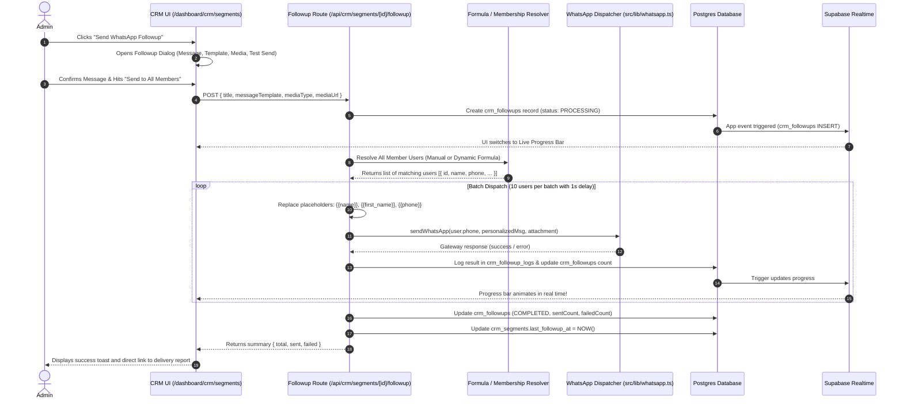

# Internal CRM & WhatsApp Segmentation Specification

This document provides the complete, production-grade architecture and implementation plan for the **Internal CRM** within `sck-4`.

The CRM operates directly on the application's existing `users` table and related operational records (`bookings`, `offering_categories`, `session_locations`, `feedbacks`, `booking_drafts`), completely eliminating data duplication.

All new pages strictly follow the project's **UI Design Standards** ([docs/ui-standards.md](file:///d:/SCK/sck-4/docs/ui-standards.md)), **Universal Database Triggers** ([triggers/universal_triggers.sql](file:///d:/SCK/sck-4/triggers/universal_triggers.sql)), and **Supabase Realtime Pub/Sub** ([docs/realtime-considerations.md](file:///d:/SCK/sck-4/docs/realtime-considerations.md)).

---

## 1. System Architecture & Core Concepts

```mermaid
graph TD
    subgraph Data Sources (Existing Database)
        U["users Table\n(Single Source of Truth)"]
        B["bookings Table"]
        OS["offering_sub_categories"]
        SL["session_locations"]
        FB["feedbacks Table"]
        BD["booking_drafts Table"]
    end

    subgraph CRM Segmentation Layer
        S["crm_segments\n(status, purpose, type)"]
        MS["Manual Segments\n(crm_manual_segment_users)"]
        DS["Dynamic Formula Engine\n(Real-time SQL Compiler)"]
    end

    subgraph Realtime & Trigger Infrastructure
        UT["universal_triggers.sql\n(notify_app_event)"]
        RT["realtime.sql\n(Supabase Realtime Pub/Sub)"]
        HOOK["useRealtime Hook\n(Live UI synchronization)"]
    end

    subgraph Messaging Layer
        WF["Send WhatsApp Followup\n(/api/crm/segments/[id]/followup)"]
        WA["Existing WhatsApp Gateway\n(src/lib/whatsapp.ts)"]
        LOGS["crm_followups & crm_followup_logs"]
    end

    U --> MS
    U --> DS
    B --> DS
    FB --> DS
    BD --> DS
    
    S --> MS
    S --> DS

    S --> UT
    MS --> UT
    LOGS --> UT
    UT --> RT
    RT --> HOOK

    MS --> WF
    DS --> WF
    WF --> WA
    WF --> LOGS
```

### Core Design Rules
1. **Purely User-Centric**: No separate `contacts` table. All CRM operations, segments, and message recipients map directly to [users](file:///d:/SCK/sck-4/src/db/schema/users.ts).
2. **Segment Types**:
   * **Manual Segments**: Seekers are added/removed manually by admins via search and multi-select.
   * **Dynamic Segments**: Members are determined by a live **Formula** (JSON query criteria). Membership is evaluated dynamically in real time whenever queried or messaged.
3. **Status & Purpose**: Every segment has an explicit administrative lifecycle:
   * **Status**: `ACTIVE`, `INACTIVE`, `ARCHIVED`, `DRAFT`.
   * **Purpose**: `RETENTION`, `ONBOARDING`, `EVENT_ANNOUNCEMENT`, `FOLLOW_UP`, `RE_ENGAGEMENT`, `FEEDBACK_COLLECTION`, `GENERAL`.
4. **"Send WhatsApp Followup" Action**:
   * An action available on every segment.
   * Resolves the full member list (either manual rows or formula matches).
   * Injects dynamic variables (e.g. `{{name}}`, `{{first_name}}`).
   * Broadcasts to all segment members via the existing [sendWhatsApp](file:///d:/SCK/sck-4/src/lib/whatsapp.ts) helper with throttling and delivery audit logs.
5. **Realtime Synchronization**:
   * Any change to a segment, manual user assignment, or live broadcast progress pushes updates immediately to the admin UI using the project's `useRealtime` hook.

---

## 2. Database Schema (`src/db/schema/crm.ts`)

```typescript
import {
  pgTable,
  uuid,
  varchar,
  text,
  timestamp,
  jsonb,
  integer,
  pgEnum,
  primaryKey,
} from "drizzle-orm/pg-core";
import { users } from "./users";

// 1. Enums
export const segmentTypeEnum = pgEnum("crm_segment_type", ["MANUAL", "DYNAMIC"]);

export const segmentStatusEnum = pgEnum("crm_segment_status", [
  "ACTIVE",
  "INACTIVE",
  "ARCHIVED",
  "DRAFT",
]);

export const segmentPurposeEnum = pgEnum("crm_segment_purpose", [
  "RETENTION",
  "ONBOARDING",
  "EVENT_ANNOUNCEMENT",
  "FOLLOW_UP",
  "RE_ENGAGEMENT",
  "FEEDBACK_COLLECTION",
  "GENERAL",
]);

export const followupStatusEnum = pgEnum("crm_followup_status", [
  "PENDING",
  "PROCESSING",
  "COMPLETED",
  "PARTIAL_FAILURE",
  "FAILED",
]);

export const followupLogStatusEnum = pgEnum("crm_followup_log_status", [
  "SENT",
  "FAILED",
  "SKIPPED_NO_PHONE",
]);

// 2. Segments Master Table
export const crmSegments = pgTable("crm_segments", {
  id: uuid("id").primaryKey().defaultRandom(),
  name: varchar("name", { length: 150 }).notNull(),
  description: text("description"),
  type: segmentTypeEnum("type").notNull(),
  status: segmentStatusEnum("status").default("ACTIVE").notNull(),
  purpose: segmentPurposeEnum("purpose").default("GENERAL").notNull(),
  color: varchar("color", { length: 20 }).default("#4f46e5"), // Badge color in UI
  formula: jsonb("formula"), // JSON AST containing dynamic conditions (null for MANUAL)
  createdBy: uuid("created_by").references(() => users.id, { onDelete: "set null" }),
  lastFollowupAt: timestamp("last_followup_at"),
  createdAt: timestamp("created_at").defaultNow().notNull(),
  updatedAt: timestamp("updated_at").defaultNow().notNull(),
});

// 3. Manual Segment Membership Table
export const crmManualSegmentUsers = pgTable(
  "crm_manual_segment_users",
  {
    segmentId: uuid("segment_id")
      .notNull()
      .references(() => crmSegments.id, { onDelete: "cascade" }),
    userId: uuid("user_id")
      .notNull()
      .references(() => users.id, { onDelete: "cascade" }),
    addedBy: uuid("added_by").references(() => users.id, { onDelete: "set null" }),
    addedAt: timestamp("added_at").defaultNow().notNull(),
  },
  (t) => [primaryKey({ columns: [t.segmentId, t.userId] })]
);

// 4. Followup Campaign Execution History
export const crmFollowups = pgTable("crm_followups", {
  id: uuid("id").primaryKey().defaultRandom(),
  segmentId: uuid("segment_id")
    .notNull()
    .references(() => crmSegments.id, { onDelete: "cascade" }),
  title: varchar("title", { length: 200 }).notNull(),
  messageTemplate: text("message_template").notNull(),
  mediaType: varchar("media_type", { length: 20 }).default("text").notNull(), // text, image, video, document, audio
  mediaUrl: text("media_url"),
  status: followupStatusEnum("status").default("PENDING").notNull(),
  totalRecipients: integer("total_recipients").default(0).notNull(),
  sentCount: integer("sent_count").default(0).notNull(),
  failedCount: integer("failed_count").default(0).notNull(),
  triggeredBy: uuid("triggered_by").references(() => users.id, { onDelete: "set null" }),
  triggeredAt: timestamp("triggered_at").defaultNow().notNull(),
  completedAt: timestamp("completed_at"),
});

// 5. Individual Followup Delivery Logs
export const crmFollowupLogs = pgTable("crm_followup_logs", {
  id: uuid("id").primaryKey().defaultRandom(),
  followupId: uuid("followup_id")
    .notNull()
    .references(() => crmFollowups.id, { onDelete: "cascade" }),
  userId: uuid("user_id")
    .notNull()
    .references(() => users.id, { onDelete: "cascade" }),
  phone: varchar("phone", { length: 30 }).notNull(),
  status: followupLogStatusEnum("status").notNull(),
  errorMessage: text("error_message"),
  sentAt: timestamp("sent_at").defaultNow().notNull(),
});
```

---

## 3. Universal Triggers & Realtime Database Integration

To integrate the new CRM tables into the universal real-time event pipeline, the following triggers must be added to [triggers/universal_triggers.sql](file:///d:/SCK/sck-4/triggers/universal_triggers.sql):

```sql
-- ==========================================
-- CRM & Segmentation Triggers
-- ==========================================

-- (25) CRM Segments Trigger
CREATE OR REPLACE TRIGGER crm_segments_app_event AFTER INSERT OR UPDATE OR DELETE
ON crm_segments FOR EACH ROW EXECUTE FUNCTION notify_app_event ();

-- (26) CRM Manual Segment Users Trigger
CREATE OR REPLACE TRIGGER crm_manual_segment_users_app_event AFTER INSERT OR UPDATE OR DELETE
ON crm_manual_segment_users FOR EACH ROW EXECUTE FUNCTION notify_app_event ();

-- (27) CRM Followups Trigger
CREATE OR REPLACE TRIGGER crm_followups_app_event AFTER INSERT OR UPDATE OR DELETE
ON crm_followups FOR EACH ROW EXECUTE FUNCTION notify_app_event ();

-- (28) CRM Followup Logs Trigger
CREATE OR REPLACE TRIGGER crm_followup_logs_app_event AFTER INSERT OR UPDATE OR DELETE
ON crm_followup_logs FOR EACH ROW EXECUTE FUNCTION notify_app_event ();
```

### Applying Database Updates
The project's automated scripts will configure REPLICA IDENTITY, Supabase Realtime publication, and RLS select policies:
```bash
npm run db:trigger   # Applies the new triggers to notify_app_event()
npm run db:realtime  # Sets REPLICA IDENTITY FULL, adds to publication, enables RLS
```

---

## 4. Realtime Pub/Sub Implementation in UI (`useRealtime`)

In accordance with [docs/realtime-considerations.md](file:///d:/SCK/sck-4/docs/realtime-considerations.md), frontend components subscribe to real-time database table mutations via [useRealtime.ts](file:///d:/SCK/sck-4/src/hooks/useRealtime.ts).

```typescript
import { useRealtime } from "@/hooks/useRealtime";
```

### Realtime Subscription Matrix

| UI Component / Page | Tables Watched | Realtime Behavior |
| :--- | :--- | :--- |
| **Segments Hub** (`/dashboard/crm/segments`) | `["crm_segments", "crm_manual_segment_users", "users", "bookings"]` | Automatically updates segment cards, member counts, and last follow-up timestamps without requiring manual page reload when users register, book, or get added. |
| **Followup Live Progress Modal** | `["crm_followups", "crm_followup_logs"]` | As the backend processes WhatsApp batches, updates `sent_count` and `failed_count` live. The progress bar advances in real time on the admin's screen! |
| **Followup Audit History** (`/dashboard/crm/followups`) | `["crm_followups"]` | Live sync of past and active campaigns, showing status changes (`PENDING` $\rightarrow$ `PROCESSING` $\rightarrow$ `COMPLETED`). |

---

## 5. UI Design Standards Compliance

All new CRM views strictly adhere to [docs/ui-standards.md](file:///d:/SCK/sck-4/docs/ui-standards.md):

### 1. Color Palette Tokens
| Token | Hex Value | Tailwind Utility | Application in CRM Views |
| :--- | :--- | :--- | :--- |
| **Deep Blue-Violet** | `#1c1f4a` | `bg-[#1c1f4a]` / `text-[#1c1f4a]` | Page titles, primary action buttons ("Create Segment", "Dispatch Followup"), modal headers. |
| **Ochre Gold** | `#b86a16` | `bg-[#b86a16]` / `text-[#b86a16]` | Formula rule builder icons, active filter chips, loading spinners, formula condition tags. |
| **Warm Light Sand** | `#faf7f2` | `bg-[#faf7f2]` | Main dashboard page background, preview summary panels. |
| **Warm Sand Border** | `#e8dcc4` | `border-[#e8dcc4]` | Segment cards, formula builder rows, modal dividers, table borders. |
| **Sage Green** | `#6b8f71` | `bg-[#6b8f71]` | `ACTIVE` status badge, successful message count, WhatsApp connected indicator. |
| **Terracotta Rust** | `#c4796a` | `bg-[#c4796a]` | `INACTIVE` / `ARCHIVED` status badges, delete segment confirm, failed message count alert. |
| **Slate Gray** | `#5a5e7a` | `text-[#5a5e7a]` | Subtitles, last followup date labels, formula criteria helper texts. |

### 2. Typography
* **Headers**: `font-display` serif typography for page `h1`, modal dialog titles, and segment names.
* **Content**: `font-sans` clean sans-serif for filter inputs, formula dropdowns, badges, and user tables.

### 3. Layout Hierarchy
* **Header Section**: Standard top section with title, subtitle, and primary CTA ("+ New Segment").
* **Loading State**: Centered full-height view with `Loader2` spinning in Ochre Gold (`text-[#b86a16]`).
* **Empty State**: Dashed Warm Sand Border card (`border-dashed border-[#e8dcc4] bg-[#faf7f2]`) alerting that no segments exist, with a centered creation button.
* **Form Modals**: Built using Radix `Dialog` overlays with Framer Motion spring transitions (`{ type: "spring", damping: 25, stiffness: 350 }`), inline field validation, disabled submit buttons during execution, and `sonner` notifications.

---

## 6. Dynamic Formula Engine (Rule Specification)

A Dynamic Segment stores its criteria in the `formula` JSONB column.

### Formula Structure
```json
{
  "combinator": "AND",
  "conditions": [
    {
      "field": "age",
      "operator": "between",
      "value": [21, 40]
    },
    {
      "field": "bookingStatus",
      "operator": "hasCompleted",
      "value": true
    },
    {
      "field": "locationId",
      "operator": "in",
      "value": ["session-location-uuid"]
    },
    {
      "field": "lastFollowupDaysAgo",
      "operator": "gte",
      "value": 7
    }
  ]
}
```

### Supported Formula Criteria

| Dimension | Field Key | Operators | Values & Meaning |
| :--- | :--- | :--- | :--- |
| **Demographics** | `age` | `equals`, `between`, `gte`, `lte` | Target specific age groups (e.g. 25–40). |
| | `dateOfBirth` | `birthdayToday`, `birthdayThisMonth`, `birthdayNext7Days`, `birthMonth` | Automated birthday greetings or birthday month offers. |
| | `gender` | `equals`, `in` | `Male`, `Female`, `Other` (e.g. women-only sessions). |
| | `phoneCode` | `equals`, `notEquals` | `+91` (Domestic) vs. International seekers. |
| | `isPhoneVerified` | `isTrue`, `isFalse` | Only verified WhatsApp numbers vs. unverified. |
| | `joinDaysAgo` | `lte`, `gte` | Registered within last N days (`lte: 7` = new seekers). |
| **Bookings** | `totalBookings` | `equals`, `gte`, `lte` | `0` = registered but never booked; `>= 3` = loyal seeker. |
| | `bookingStatus` | `in` | `confirmed`, `completed`, `pending`, `cancelled`. |
| | `subCategoryId` | `in` | Specific offering sub-categories (e.g. Kriya, Hatha Yoga). |
| | `selectedFormat`| `equals` | `online` vs. `offline`. |
| | `locationId` | `in` | Specific offline centre ([session_locations](file:///d:/SCK/sck-4/src/db/schema/session_locations.ts)). |
| | `lastBookingDaysAgo` | `lte`, `gte` | `lte: 30` (Active) vs. `gte: 90` (Dormant / Churn Risk). |
| | `upcomingBookingDays` | `lte` | Has confirmed booking within next `1`, `3`, or `7` days. |
| **Funnel & Intent** | `hasAbandonedDraft` | `isTrue` | Started booking checkout within 48h without paying. |
| **Feedback** | `feedbackRating`| `equals`, `gte`, `lte` | `>= 5` (Promoters) vs. `<= 3` (Detractors). |
| | `missingFeedback` | `isTrue` | Completed booking in last 3 days with no feedback yet. |
| **Hygiene** | `lastFollowupDaysAgo`| `gte` | Has not received a WhatsApp followup in N days (prevents spam). |

---

## 7. "Send WhatsApp Followup" Workflow



### Personalization Variable Mapping
* `{{name}}` $\rightarrow$ Full seeker name (e.g. "Srikanth Sharma")
* `{{first_name}}` $\rightarrow$ First name (e.g. "Srikanth")
* `{{phone}}` $\rightarrow$ Formatted phone number

---

## 8. API Endpoints

### 1. Segments Management
* `GET /api/crm/segments`: Returns all segments with their type, purpose, status, and dynamic/manual member count.
* `POST /api/crm/segments`: Creates a new segment (Manual or Dynamic with formula).
* `GET /api/crm/segments/[id]`: Returns detailed segment info, formula/member list, and past followup campaigns.
* `PATCH /api/crm/segments/[id]`: Updates segment details, status, purpose, or formula.
* `DELETE /api/crm/segments/[id]`: Deletes the segment.

### 2. Dynamic Formula Preview
* `POST /api/crm/segments/preview`:
  * **Input**: `{ formula: { ... } }`
  * **Output**: `{ totalMatched: 142, reachableWhatsApp: 139, sampleUsers: [...] }`
  * Allows live UI preview before saving a dynamic segment.

### 3. Manual Membership
* `POST /api/crm/segments/[id]/members`: Add users to a manual segment `[userIds]`.
* `DELETE /api/crm/segments/[id]/members`: Remove users from a manual segment `[userIds]`.

### 4. WhatsApp Followup Dispatch
* `POST /api/crm/segments/[id]/followup`:
  * **Input**:
    ```json
    {
      "title": "Weekend Kriya Workshop Reminder",
      "message": "Namaskaram {{first_name}},\nWe look forward to seeing you this weekend...",
      "mediaType": "image",
      "mediaUrl": "https://..."
    }
    ```
  * Triggers batch dispatch, updates `crm_followups`, and writes `crm_followup_logs`.
* `POST /api/crm/segments/[id]/followup/test`:
  * Sends a single rendered test message to an admin phone number for review before the full blast.

---

## 9. Frontend Navigation & Dashboard Structure

Add a dedicated **CRM** section to [src/app/dashboard/layout.tsx](file:///d:/SCK/sck-4/src/app/dashboard/layout.tsx):

```typescript
{
  title: "CRM & Segmentation",
  items: [
    { name: "Segments Hub", href: "/dashboard/crm/segments", icon: Users2 },
    { name: "Followup History", href: "/dashboard/crm/followups", icon: History },
  ],
}
```

### UI Screens
1. **`/dashboard/crm/segments` (Main Segments Hub)**:
   * Header with "+ Create Segment" (Modal for Manual or Dynamic).
   * Filter segments by **Status** (`ACTIVE`, `INACTIVE`) and **Purpose** (`RETENTION`, `ONBOARDING`, etc.).
   * Segment Cards/Table using standard tokens (`bg-white border-[#e8dcc4] text-[#1c1f4a]`):
     * Segment Name & Purpose Badge (colored by purpose).
     * Type Badge: `Dynamic (Formula)` vs. `Manual (List)`.
     * Member Count (live calculated for dynamic, row count for manual).
     * Last Followup Date.
     * Primary Action: **"Send WhatsApp Followup"** button with WhatsApp icon (`bg-[#1c1f4a] hover:bg-[#b86a16]`).
     * Edit / Delete dropdown menu.
   * Uses `useRealtime(["crm_segments", "crm_manual_segment_users", "users", "bookings"], refetch)` for zero-latency live updates.
2. **`/dashboard/crm/segments/new` (Visual Segment Builder Modal)**:
   * Segment Details: Name, Purpose, Status, Color.
   * Type Selector: `Manual` vs `Dynamic`.
   * **If Manual**: User selector with search, role filters, and pagination.
   * **If Dynamic**: Visual Formula Builder:
     * Add condition row (Field $\rightarrow$ Operator $\rightarrow$ Value).
     * Live audience counter widget (`"Matching 142 Seekers (139 with WhatsApp)"`).
3. **"Send WhatsApp Followup" Modal**:
   * Displays segment name, recipient count, and purpose.
   * Message composer with placeholder insertion chips (`{{first_name}}`, `{{name}}`).
   * Media attachment selector (Text, Image URL / Upload, Document PDF).
   * Test Send input (phone number + "Send Test" button).
   * "Dispatch Followup" button with confirmation.
   * Live animated progress bar driven by `useRealtime(["crm_followups"])`.
4. **`/dashboard/crm/followups` (Audit & History)**:
   * List of all past broadcasts with status, total recipients, sent count, failed count, timestamp, and sender.
   * Clickable into granular per-user delivery logs.

---

## 10. Implementation Roadmap & Steps

### Step 1: Database Setup & Universal Triggers
1. Create `src/db/schema/crm.ts` with all tables and enums.
2. Export it in [src/db/schema/index.ts](file:///d:/SCK/sck-4/src/db/schema/index.ts).
3. Apply migration to the database via `npx drizzle-kit push`.
4. Append triggers `(25)` through `(28)` to [triggers/universal_triggers.sql](file:///d:/SCK/sck-4/triggers/universal_triggers.sql).
5. Run trigger and realtime setup scripts:
   ```bash
   npm run db:trigger
   npm run db:realtime
   ```

### Step 2: Formula Query Compiler & Member Resolver
1. Create `src/lib/crm/formula-compiler.ts`:
   * Compiles JSON formula conditions into Drizzle SQL `WHERE` clauses against `users`, `bookings`, `feedbacks`, etc.
2. Create `src/lib/crm/segment-service.ts`:
   * Resolves members for both manual and dynamic segments.
   * Calculates live counts and preview samples.

### Step 3: API Route Implementation
1. `src/app/api/crm/segments/route.ts` (GET, POST)
2. `src/app/api/crm/segments/[id]/route.ts` (GET, PATCH, DELETE)
3. `src/app/api/crm/segments/[id]/members/route.ts` (POST, DELETE)
4. `src/app/api/crm/segments/[id]/followup/route.ts` (POST dispatch)
5. `src/app/api/crm/segments/[id]/followup/test/route.ts` (POST test send)
6. `src/app/api/crm/segments/preview/route.ts` (POST preview count)

### Step 4: UI Development (UI Standards & Realtime)
1. Build Segments list page `src/app/dashboard/crm/segments/page.tsx` incorporating `useRealtime` and design tokens (`#1c1f4a`, `#b86a16`, `#e8dcc4`).
2. Build Segment creation dialog with visual formula builder.
3. Build Followup WhatsApp modal with live real-time progress bar and test-send capability.
4. Build Followup History page `src/app/dashboard/crm/followups/page.tsx`.
5. Register CRM navigation in [src/app/dashboard/layout.tsx](file:///d:/SCK/sck-4/src/app/dashboard/layout.tsx).

### Step 5: Verification & End-to-End Testing
1. Create a manual segment with test users $\rightarrow$ trigger test follow-up.
2. Create a dynamic segment with formula (e.g. `age > 20 AND isPhoneVerified = true`) $\rightarrow$ verify matching count.
3. Test WhatsApp dispatch with personalized variables (`{{first_name}}`) using [sendWhatsApp](file:///d:/SCK/sck-4/src/lib/whatsapp.ts).
4. Verify Realtime WebSocket notifications update the UI without manual page reloads.
